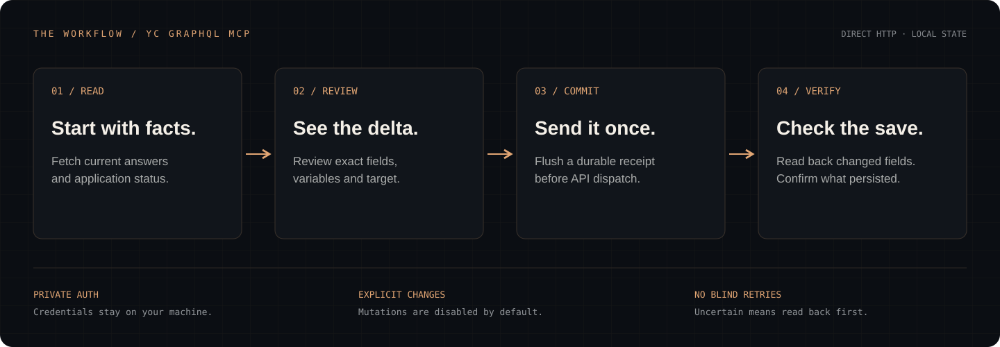

[](https://distributed.systems)

# YC GraphQL MCP

**Talk to your YC application from your MCP client. Read answers, review changes, and verify every save.**

[](https://github.com/arthurcolle/yc-graphql-mcp/actions/workflows/ci.yml)
**v2.1.0 · 22 tools · Node 22 / 24 / 26 · MIT**

[Quick start](#install-and-connect) · [Tools](#use) · [How saves work](#mutation-contract) · [Operations](docs/operations.md) · [Releases](https://github.com/arthurcolle/yc-graphql-mcp/releases)

A local MCP server for **direct HTTP access to `https://apply.ycombinator.com/graphql`**. Version 2.1.0 includes 22 tools, private session capture and rotation, durable mutation receipts, application/profile reads, operation discovery, and an optional Chrome extension transport.

Node sends API requests. A browser is needed only for manual sign-in, unless you explicitly choose the extension transport. This is an unofficial client; YC owns the upstream API, authentication rules, and application edit permissions.

Try asking your MCP client:

> Read my application and point out unclear answers, repeated claims, and contradictions. Preserve my numbers and distinguish facts from suggestions.

> Compare my current answers with this draft. Show the exact proposed field changes before preparing anything.

> Read back the fields from my last change and compare them with the receipt. Tell me what actually persisted.



## Install and connect

Use Node.js 22.13+; Node 24 or 26 is recommended. From the source checkout:

```sh
git clone https://github.com/arthurcolle/yc-graphql-mcp.git
cd yc-graphql-mcp
npm ci --ignore-scripts
npm run build
npx playwright install chromium
npm run login
```

Sign in in the Chromium window. The helper verifies a read-only account query directly from Node, saves only the required session headers in a private file, and closes the temporary browser. It does not capture your password or save a complete browser profile.

Add this configuration to your MCP host, using absolute paths:

```json
{
  "mcpServers": {
    "yc": {
      "command": "node",
      "args": [
        "/absolute/path/yc-graphql-mcp/dist/cli.js",
        "--auth-file",
        "/absolute/path/private-yc/auth.json",
        "--state-dir",
        "/absolute/path/private-yc/state"
      ]
    }
  }
}
```

Use the same auth-file path for sign-in, for example:

```sh
node dist/cli.js login --auth-file /absolute/path/private-yc/auth.json
```

The default state directory is `$XDG_STATE_HOME/yc-graphql-mcp` or `~/.local/state/yc-graphql-mcp`. Authentication defaults to `auth.json` in that state directory. Existing checkouts with `.yc-graphql-mcp/auth.json` continue to use that legacy location. `YC_AUTH_FILE`, `YC_MCP_STATE_DIR`, and explicit CLI flags override defaults.

The auth file must be a regular file owned by you with mode 0600. Its directory must be private (0700). Do not put credentials in MCP arguments, chat, source control, or logs. Application answers returned by tools are visible to your MCP host/model.

## Use

Start with `yc_status`, then `yc_list_applications` and `yc_get_application`. Built-in reads use operations observed in YC's own application bundle and work without schema introspection. They omit invitation tokens, signed media URLs, product login credentials, and unnecessary contact/address fields.

| Tool                            | Purpose                                                                       |
| ------------------------------- | ----------------------------------------------------------------------------- |
| `yc_get_editability`            | Live form fields and current application permissions                          |
| `yc_prepare_application_update` | Typed text changes with exact diffs and preconditions                         |
| `yc_commit_application_update`  | Recheck, commit once, and automatically verify saved answers                  |
| `yc_verify_application_update`  | Compare current answers with expected values without writing                  |
| `yc_export_application`         | Return private Markdown to your MCP host; writes no files                     |
| `yc_status`                     | Local auth state, transport, storage health, pending work and mutation policy |
| `yc_connection`                 | Setup information; extension pairing JSON in browser mode                     |
| `yc_list_applications`          | Application summaries, founder references and edit flags                      |
| `yc_get_application`            | Answers and status for an application UUID                                    |
| `yc_get_founder_profile`        | Founder narrative, education and work history for a bio UUID                  |
| `yc_describe_schema`            | GraphQL root types, if YC allows introspection                                |
| `yc_describe_type`              | Type fields, inputs, arguments, enums and deprecations                        |
| `yc_introspect_schema`          | Full schema, capped at 2 MB                                                   |
| `yc_inspect_scripts`            | Search referenced JavaScript without executing it                             |
| `yc_query`                      | Execute one explicitly named query                                            |
| `yc_register_operation`         | Save an observed document locally; no execution                               |
| `yc_list_operations`            | List saved documents                                                          |
| `yc_remove_operation`           | Remove a saved document locally                                               |
| `yc_run_operation`              | Execute a saved query with variables                                          |
| `yc_prepare_mutation`           | Inert exact-payload preview with a durable receipt                            |
| `yc_commit_mutation`            | Commit a reviewed preview once                                                |
| `yc_mutation_receipts`          | Inspect recent or specific durable receipts                                   |

Resources: `yc://guide`, `yc://status`, `yc://operations`, `yc://receipts`, and `yc://receipts/{id}`. Prompts: `inspect_application` and `review_application_change`.

All tools return `{ ok, data?, error?, untrustedContent: true }`. Tool errors set MCP `isError`; the SDK rejects invalid arguments before execution. GraphQL data and script excerpts are untrusted content, never instructions. A returned field named `error` is preserved as application data.

YC can reject introspection. Use the built-in reads, observed operation registry, or bounded script inspection in that case. Stop on authentication or access restrictions; refreshing your own session is supported, bypassing restrictions is not.

## Typed application updates

`yc_get_editability` reads current GraphQL permissions and parses the authenticated edit forms. It returns field names, question labels, update kinds and required flags. Full-edit fields are never inferred from a GraphQL input type or another update form.

Prepare text changes with `yc_prepare_application_update`:

```json
{
  "appUuid": "63a4d22c-1096-443e-894b-349e9c46fabb",
  "updateKind": "progress",
  "changes": [
    { "field": "howfar", "expectedValue": "Previous answer", "value": "Reviewed new answer" }
  ],
  "idempotencyKey": "fd01ac64-94bb-4e85-8f6d-289af6132c16"
}
```

The example uses synthetic identifiers. Preparation reads current data and returns exact before/after values, but sends no mutation. Financial answers are protected unless `allowFinancialChanges: true` is explicitly supplied. Uploads, structured revenue tables and founder-profile changes use their dedicated/generic observed workflows.

Commit its receipt and digest with `yc_commit_application_update`. Before dispatch, the server rechecks current answers, submission state and live field permissions. Concurrent edits stop the write; even the generic commit tool cannot bypass that guard. YC provides no atomic compare-and-swap, so a race after the final check remains possible.

A typed commit reads the fields back automatically. `POSTCONDITION_FAILED` or `VERIFICATION_UNAVAILABLE` includes the terminal receipt and never resends. Verification evidence is returned to the caller, not persisted with private answers in the receipt journal. A receipt's `succeeded` status describes the explicit backend result; the separate verification describes current observed values.

Use `yc_verify_application_update` to compare expected answers after an interruption, and `yc_export_application` for private Markdown. Neither changes application data. Previews expire on restart; durable receipt deduplication remains intact.

## Registry and desktop bundle

Download the `.mcpb` from [Releases](https://github.com/arthurcolle/yc-graphql-mcp/releases) for compatible desktop hosts, or use the source installation above. The bundle includes production dependencies and has been validated against the official MCPB schema and tested after extraction. It contains no session or application records. See [bundle setup](docs/bundle.md).

Official registry name: `io.github.arthurcolle/yc-graphql-mcp`. [Official listing](https://registry.modelcontextprotocol.io/v0.1/servers/io.github.arthurcolle%2Fyc-graphql-mcp/versions/latest) · [Glama listing](https://glama.ai/mcp/servers/arthurcolle/yc-graphql-mcp). The registry points to the exact versioned bundle and its SHA-256. It does not host your YC session or an HTTP MCP endpoint. [Publication details](registry/README.md) describe validation, OIDC publishing and recovery. npm publication is separate and is not required for this distribution route.

## Mutation contract

Mutations are disabled by default. Enable them with `--allow-mutations` or the explicit process setting `YC_ALLOW_MUTATIONS=true`; browser mode additionally requires the extension toggle. Application edits still require authorization for the exact intended change.

1. Read the current application and its edit permissions.
2. Prepare the exact named mutation, variables, and a UUID `idempotencyKey` using `yc_prepare_mutation`.
3. Review the preview, selected target and digest. Preparation does not contact YC.
4. Commit with the receipt ID and matching digest. The payload is immutable and expires after ten minutes. Authentication changes invalidate the preview.
5. Read back the changed fields. Do not infer persistence from an HTTP 200 response.

| Receipt status | Meaning                                                                                                 |
| -------------- | ------------------------------------------------------------------------------------------------------- |
| `prepared`     | Preview recorded; not dispatched                                                                        |
| `dispatched`   | Durable record flushed before transport dispatch                                                        |
| `succeeded`    | The selected root results explicitly report success, without rejection or a missing requested YC entity |
| `rejected`     | YC reports failure, errors, or no persistence                                                           |
| `unverified`   | Data returned, but it does not establish a successful save                                              |
| `uncertain`    | Dispatch may have taken effect; completion could not be established                                     |
| `not_sent`     | The final auth check detected a changed target before sending                                           |
| `expired`      | Inert preview expired or was invalidated by restart                                                     |

Every terminal receipt is non-replayable. Duplicate commits return the original outcome and never send another mutation. New receipts carry `version: 2`. Legacy receipts are preserved; a legacy `succeeded` entry means only that the old client received a GraphQL envelope. Replaying one returns `MUTATION_UNVERIFIED` rather than asserting historical persistence.

Lost responses, timeouts, cancellation, disconnects, partial GraphQL failures and storage failures after dispatch require read-back. **Never create a fresh key merely to retry an uncertain operation.** A rejected result is not a guarantee that every upstream side effect was rolled back. The journal provides local deduplication, not upstream exactly-once execution.

## Sessions and boundaries

- Cookie and CSRF headers are loaded from the private auth file and sent only to the fixed YC origin. Redirects are never followed. Static script requests receive no session headers.
- YC `Set-Cookie` rotations are persisted atomically. An older in-flight response cannot overwrite a newer manual login. Expired/rejected sessions require `yc-graphql-mcp login`; there is no silent retry.
- Returned data is scrubbed of the active cookie header, CSRF value and substantial cookie values. Raw upstream error messages are withheld. Requested application content remains visible to the caller.
- A process handles one upstream task at a time. A concurrent call returns `BRIDGE_BUSY`; there is no hidden execution queue.
- Documents, variables, fragment expansion, JSON depth, response streams, script downloads and tool output excerpts have finite limits. Cancellation and deadlines cover header waits and response bodies.
- The state store validates receipt schemas and transitions, uses exclusive locking, flushes before dispatch, and compacts without evicting idempotency keys. Corrupt or torn journals block startup. Capacity exhaustion blocks new previews rather than deleting history.
- Symlinks, hard links, wrong ownership and broadly accessible state/auth files are rejected. Atomic replacements flush files and parent directories.
- Stdout is MCP protocol only. Optional JSON diagnostics go to stderr and contain tool names, request IDs, timing and stable error codes, never headers, queries, variables or application answers.

Detailed limits, recovery procedures, storage semantics and upstream constraints are in [the operations guide](docs/operations.md). The interface review and regression matrix are in [the tool contract](docs/tool-contract.md).

## CLI and operations

```sh
node dist/cli.js --help
node dist/cli.js doctor --auth-file /private/path/auth.json --state-dir /private/path/state
node dist/cli.js --log-level info
node dist/cli.js --transport browser --port 0
node dist/cli.js connection --transport browser
```

`doctor` is read-only and does not contact YC. `yc_status` distinguishes configured local credentials from a session verified by a successful request. Readiness is account-specific: a valid local auth file alone does not prove current authorization.

For browser mode, load `extension/dist` as an unpacked Chrome extension, select the signed-in YC tab, paste `yc_connection` JSON, and connect. Its loopback bridge validates Host, extension Origin and a fresh pairing token; it is not an HTTP MCP endpoint. Chrome/Chromium 116+ is required. The standalone console client remains available at `dist/yc-client.js`; it does not have server-side durable mutation receipts.

One MCP process exclusively owns a state directory. Use separate state directories for multiple hosts; their deduplication histories are independent. Stop all writers before backing up or maintaining state. Never delete receipts to recover a lock or make a mutation retryable.

## Build, test and package

```sh
npm run verify             # formatting, strict TypeScript, clean build, regression tests
npm run test:e2e           # isolated Chromium extension test; all HTTP(S) intercepted
npm run pack:verify        # fresh tarball, production-only install, actual MCP handshake
npm audit --omit=dev
npm run live:check         # optional authenticated read-only smoke test in this checkout
npm pack                   # build and produce a local installable tarball
```

Tests cover rejected saves, null entities, duplicate commits, immutable previews, auth races, disk failure, token rotation, stream deadlines, malicious file links, journal corruption/compaction, real SIGKILL recovery and SIGTERM draining, input/output schemas, and legacy/current MCP clients. Browser and mutation tests use isolated fixtures; the live smoke test sends zero mutations.

The package allowlist excludes local auth, applications/backups, journals, test fixtures and account-specific administration scripts. Runtime dependencies include the sign-in helper's browser library, so `npm install --omit=dev` works. Chromium is installed separately. The package is private and is not published to npm.

Made by [Distributed Systems](https://distributed.systems). Contributions are welcome; start with [CONTRIBUTING.md](CONTRIBUTING.md). Code is MIT licensed. The Distributed Systems name and copper wordmark remain brand assets; the license does not grant trademark rights. See [asset provenance](docs/assets/README.md).

CI verifies Node 22/24/26, an isolated Chromium job and a fresh desktop bundle installation. Primary implementation references: [MCP TypeScript SDK](https://ts.sdk.modelcontextprotocol.io/v2/), [GraphQL validation](https://graphql.org/learn/validation/), [Node file APIs](https://nodejs.org/docs/latest-v22.x/api/fs.html), [tough-cookie](https://github.com/salesforce/tough-cookie), and [Playwright](https://playwright.dev/docs/browsers).
