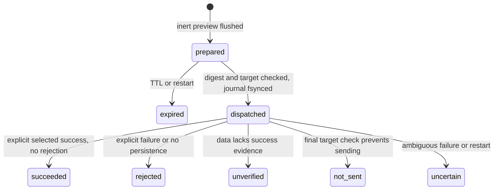

# Tool contract and production review

## Version 2 contract changes

| Prototype behavior                                             | Version 2 behavior                                                                                                                                                             |
| -------------------------------------------------------------- | ------------------------------------------------------------------------------------------------------------------------------------------------------------------------------ |
| A successful GraphQL envelope could mark a mutation successful | Inspect selected root results, including aliases and fragments; explicit failure is `rejected`, missing success evidence or a requested missing/null YC entity is `unverified` |
| Mutable preview objects                                        | Defensive copies, canonical digest, and final payload/session checks                                                                                                           |
| Receipts without validated transitions                         | Strict schema, immutable identity, monotonic state machine and fsynced dispatch/outcome records                                                                                |
| Unbounded receipt growth or opportunistic recovery             | Finite admission, compaction retaining every key, poisoned writes after durable failure, and fail-closed corrupt/torn journals                                                 |
| File-based session loading                                     | Private owned files, no leaf symlinks/hard links, validated headers, atomic cookie rotation and newer-login protection                                                         |
| Timeout mostly covered fetch initiation                        | Deadline and cancellation cover header waits and body streams, including adapters that ignore AbortSignal                                                                      |
| Development-only sign-in dependency                            | Packaged compiled login command with its runtime dependency, plus read-only `doctor`                                                                                           |
| Generic GraphQL discovery only                                 | Three source-observed account/application/profile reads, alongside the generic registry/discovery tools                                                                        |
| Prototype installation                                         | Typed public ESM API, pinned dependencies, package allowlist and a fresh production-only installation test                                                                     |

The server/package version is 2.0.0. Tool names and the standard result envelope remain compatible; mutation success semantics are deliberately stricter. New receipts carry `version: 2`. Historical receipts are preserved for deduplication. A legacy `succeeded` receipt retains its historical status but commit replay returns `MUTATION_UNVERIFIED`, without sending anything.

The original console client's named request shape remains available in the browser bundle. Anonymous/multiple operations, mismatched names, subscriptions and executable/schema definitions are rejected. Application identifiers and proposed answer text are caller inputs, not hardcoded mutation targets. The standalone console bundle has no server-side durable receipts.

## Identity, schemas and execution

The actor is the local MCP host running a stdio process as the state/auth file owner. Direct HTTP is the default and exposes no listener. The sign-in helper opens a temporary browser for manual authentication, verifies a direct account read, and captures only the required session headers. Node sends those headers only to the fixed YC origin. Optional browser mode instead pairs an extension over an authenticated loopback WebSocket and binds requests to the selected tab/document. YC enforces account and application authorization in both modes.

There are 17 tools, four fixed resources, one receipt resource template and two prompts; see [README](../README.md) for the complete inventory. Tool inputs are strict JSON Schema objects with unknown properties rejected. Identifiers use whole-value ASCII validation, UUIDs have fixed length, and documents/variables have runtime complexity and byte checks. The official SDK validates actual advertised input/output schemas; protocol tests additionally compile them with AJV.

Tools cannot accept credential headers, endpoint overrides, filesystem paths or executable JavaScript. Paths and transport policy are process-level CLI/environment configuration. Extension pairing is a local capability; the token is never placed in a URL. Application content, observed scripts, prompts and upstream errors cannot authorize new actions.

Read tools are annotated read-only. Registry/preview tools declare local writes. Commit declares possible external changes. An annotation or valid schema alone is not permission. Committing requires the server mutation flag, an unexpired immutable preview, matching digest and the same authenticated target at final dispatch. Browser mode additionally requires the extension toggle. The host obtains authorization appropriate to the exact requested change.

## Results, failures and logs

Successful tools return:

```json
{ "ok": true, "data": {}, "untrustedContent": true }
```

Tool failures set MCP `isError: true` and return:

```json
{
  "ok": false,
  "error": { "code": "STABLE_CODE", "message": "Bounded explanation" },
  "untrustedContent": true
}
```

Dispatched mutation failures include `data.receipt`. Other bounded error metadata may include HTTP status and retry timing. A legitimate GraphQL field named `error` stays inside application data; it is not confused with the tool envelope. Invalid MCP arguments are SDK protocol errors, before the handler executes.

Important error groups:

| Condition                 | Codes                                                                                                                                                                                     |
| ------------------------- | ----------------------------------------------------------------------------------------------------------------------------------------------------------------------------------------- |
| Invalid document or input | `INVALID_DOCUMENT`, `INVALID_OPERATION_NAME`, `OPERATION_MISMATCH`, `DOCUMENT_TOO_COMPLEX`, `INVALID_VARIABLES`, `SUBSCRIPTION_UNSUPPORTED`                                               |
| Authentication            | `AUTH_REQUIRED`, `AUTH_EXPIRED`, `AUTH_FILE_INVALID`, `AUTH_PERSIST_FAILED`, `CSRF_REJECTED`                                                                                              |
| Transport or response     | `BRIDGE_BUSY`, `BROWSER_DISCONNECTED`, `BRIDGE_TIMEOUT`, `NETWORK_ERROR`, `TIMEOUT`, `CANCELLED`, `HTTP_ERROR`, `RATE_LIMITED`, `INVALID_RESPONSE`, `RESPONSE_TOO_LARGE`, `GRAPHQL_ERROR` |
| Mutation policy/outcome   | `MUTATION_BLOCKED`, `IDEMPOTENCY_CONFLICT`, `DIGEST_MISMATCH`, `PREVIEW_EXPIRED`, `TARGET_CHANGED`, `MUTATION_NOT_SENT`, `MUTATION_REJECTED`, `MUTATION_UNVERIFIED`, `MUTATION_UNCERTAIN` |
| Local state               | `STATE_LOCKED`, `STATE_CORRUPT`, `STATE_CAPACITY`, `STATE_WRITE_FAILED`, `RECEIPT_NOT_FOUND`, `OPERATION_EXISTS`, `OPERATION_NOT_FOUND`, `REGISTRY_FULL`                                  |

No operation is retried automatically. HTTP 429 exposes bounded retry metadata where available; it does not trigger a retry. Raw GraphQL/provider error text is withheld because it can echo private values. Known active cookie/CSRF values are scrubbed from direct transport results. Generic queries and script excerpts can still contain application secrets explicitly selected by the caller. Built-in reads omit unnecessary sensitive fields; outputs remain untrusted account data visible to the host/model.

Structured stderr logs contain fixed event/code fields, request IDs, tool names, durations and transport/version metadata. They never include documents, variables, answers, credential values or upstream error bodies. Stdout is reserved for MCP protocol in serve mode.

## Durable mutation state machine



All terminal states are non-replayable. Duplicate commits return the original receipt; `dispatched` is conservatively reported uncertain, without another dispatch. A fresh idempotency UUID must never conceal uncertainty. Rejection does not prove all upstream side effects were rolled back. Even `succeeded` requires business postcondition read-back.

The UUID key binds a SHA-256 digest of normalized document, operation name and canonical JSON variables. Its namespace is the exclusively locked state directory, not the YC account. The store flushes reservation and dispatch before transport execution. Completion is flushed before returning. Mutation variables and response bodies are not persisted in receipt records. A write failure stops subsequent writes in that process and returns the affected receipt when available.

At startup, prepared records expire and dispatched records become uncertain. Strict validation rejects invalid transitions, identity rewrites and torn/corrupt journals. Compaction preserves every latest receipt and key. Capacity exhaustion stops admission; keys are never silently evicted. These controls provide local deduplication, not upstream exactly-once execution. Full bounds, backup and recovery procedures are in [the operations guide](operations.md).

## Verification matrix

| Case                                                                                     | Expected result                                                                                 | Test evidence                                     |
| ---------------------------------------------------------------------------------------- | ----------------------------------------------------------------------------------------------- | ------------------------------------------------- |
| Hidden mutation, anonymous/multiple operation, mismatched name or subscription           | Reject before dispatch                                                                          | GraphQL, service and protocol tests               |
| Cyclic/undefined unused fragments, oversized/deep/non-JSON variables                     | Bounded local rejection                                                                         | GraphQL and production tests                      |
| Identifier/UUID trailing newline, CRLF, tab, NUL, Unicode separator                      | Reject whole value                                                                              | Runtime checks and AJV against advertised schemas |
| Unknown tool properties / endpoint injection                                             | Strict schema rejection                                                                         | Protocol tests                                    |
| Website/missing Origin or incorrect token on loopback bridge                             | Reject pairing                                                                                  | Bridge tests                                      |
| Unknown response ID or late response                                                     | Never correlate to another request                                                              | Bridge tests                                      |
| Missing mutation policy, wrong digest, changed session                                   | No effect                                                                                       | Mutation and direct transport tests               |
| Caller mutates returned preview/registry object                                          | Stored payload remains unchanged                                                                | Production tests                                  |
| Concurrent duplicate commit, committed effect with lost response                         | One synthetic effect, original terminal receipt                                                 | Mutation/direct tests                             |
| `success: false`, `persisted: false` or errors in HTTP 200 data                          | Durable rejected receipt, MCP error                                                             | Production tests                                  |
| Success with missing/null requested entity, aliased/fragments or malformed status fields | Unverified; no false success                                                                    | Production tests                                  |
| Version 1 succeeded receipt replay                                                       | `MUTATION_UNVERIFIED`, no dispatch                                                              | Production tests                                  |
| Session changes at final dispatch boundary                                               | Durable `not_sent`, zero effects                                                                | Production tests                                  |
| Storage failure after synthetic effect                                                   | Receipt returned, no redispatch                                                                 | Production tests                                  |
| Successful Set-Cookie rotation / newer manual login                                      | Private persistence / old response cannot overwrite new login                                   | Production tests                                  |
| Provider echoes session secrets                                                          | Known values redacted                                                                           | Direct and production tests                       |
| Missing/broadly accessible auth, malicious symlink or hard link                          | Reject before unsafe I/O                                                                        | Direct and production tests                       |
| Torn journal, tampered terminal state                                                    | Block startup; retain bytes                                                                     | Store and production tests                        |
| Compaction                                                                               | Every latest key retained                                                                       | Production tests                                  |
| Fetch/body stream ignores abort                                                          | Request still reaches deadline                                                                  | Production tests                                  |
| HTTP auth failure, redirect, 429, malformed envelope or partial GraphQL error            | Stable failure; no hidden retry or partial data                                                 | Browser/direct/production tests                   |
| Huge streamed response or script outside permitted origins                               | Bounded rejection / never fetch                                                                 | Browser client tests                              |
| Manual sign-in capture fails or is cancelled                                             | Existing auth preserved                                                                         | Login tests                                       |
| Actual child killed after fake effect                                                    | Restart yields uncertain; no duplicate effect                                                   | SIGKILL process test                              |
| Actual CLI receives SIGTERM during in-flight mutation                                    | Drain, uncertain receipt, clean lock release                                                    | SIGTERM process test                              |
| Legacy and current protocol clients                                                      | Actual built CLI tools/resources/prompts/output schemas work                                    | Official SDK stdio clients                        |
| Extension pairing, query, scripts, mutation and read-back                                | Real Chromium extension/page fetch; synthetic credentials stay private                          | Isolated browser test; all HTTP(S) intercepted    |
| Production-only package install                                                          | Public API and actual installed CLI work without dev dependencies; no local private/admin files | Tarball installation verifier                     |
| Optional live account smoke                                                              | Built CLI can read application/profile; no mutation sent                                        | Credential-free local verification receipt        |

Dependencies and validator versions are pinned in `package-lock.json`. Automated mutation/browser tests use synthetic accounts and effects. Live checks are opt-in, account-specific and read-only. They do not establish upstream mutation permission or constitute a hosted CI run.
